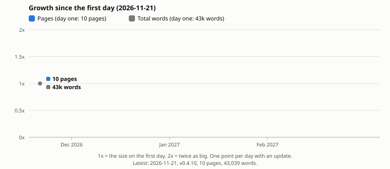

# Changelog

<!-- SUMMARY:START (this block is rebuilt by tools/build.py; do not edit by hand) -->
## At a glance

| Version | Date | What changed, in one line | Pages on site | Time spent |
|---|---|---|---|---|
| **v0.2.5** | 2026-11-21 | Chart and summary table added at the top of this changelog. | 6 | about 10 minutes |
| **v0.2.4** | 2026-11-21 | Left-side chapter menu on every page. | 6 | about 10 minutes |
| **v0.2.3** | 2026-11-21 | 'In his own words' section from Yoshida's X account. | 6 | about 10 minutes |
| **v0.2.2** | 2026-11-21 | 'What fans are saying' section from Yahoo! News Japan comments. | 6 | about 10 minutes |
| **v0.2.1** | 2026-11-21 | Agents overview gets the story, trends and 2026 outlook; new pages for Hai Berden and Kees Ploegsma Jr. | 6 | about 20 minutes |
| **v0.2.0** | 2026-11-21 | New Agents folder: overview, Tetsuro Kiyooka and Thomas Kroth; Yoshida's agent details corrected. | 4 | about 45 minutes (5 research helpers running in parallel) |
| **v0.1.2** | 2026-11-21 | Three deep dives for Yoshida: the Vera&John ad deal, being a target, sports agents. | 1 | about 25 minutes |
| **v0.1.1** | 2026-11-21 | Controversies and criticism section added to Yoshida and to the template. | 1 | about 10 minutes |
| **v0.1.0** | 2026-11-21 | First person added: Maya Yoshida profile, printable web page, build tool and template. | 1 | about 1 hour (one Claude session, with 5 research helpers running in parallel) |

🤖 = found by the weekly scheduled check. Full details for each version are below.
<!-- SUMMARY:END -->

How to add an entry: put it directly below this line, newest first. Start with `## vX.Y.Z — YYYY-MM-DD`, then `**Summary:**` (one sentence), `**Pages on site:**` (a number), `**Time spent:**`, `**What changed**` and `**Why**`. The chart and table above update when `python tools/build.py` runs.

## v0.2.5 — 2026-11-21
**Summary:** Chart and summary table added at the top of this changelog.  
**Pages on site:** 6  
**Time spent:** about 10 minutes

**What changed**
- The top of `CHANGELOG.md` now has a line chart (pages on the site after each version) and a table with one line per version.
- Both are rebuilt automatically by `tools/build.py` from the entries below, so they stay up to date.

**Why**
- To see the history at a glance before reading the details.

## v0.2.4 — 2026-11-21
**Summary:** Left-side chapter menu on every page.  
**Pages on site:** 6  
**Time spent:** about 10 minutes

**What changed**
- Every page with three or more chapters now has a "Chapters" menu on the left side. Click a chapter to jump to it. The menu stays in view while you scroll and highlights the chapter you are reading.
- On a narrow screen or phone the menu moves to the top and can be folded away. It is hidden when printing.
- The menu is built automatically from each page's chapter headings, so new people and new sections get it with no extra work.

**Why**
- Profiles are getting long. This gives a quick snapshot of what is on the page and a fast way to move around.

## v0.2.3 — 2026-11-21
**Summary:** 'In his own words' section from Yoshida's X account.  
**Pages on site:** 6  
**Time spent:** about 10 minutes

**What changed**
- New section in Maya Yoshida's profile: "In his own words (social posts)", with three recent posts from his X account described and linked. Noted that he had posted nothing about leaving LA Galaxy as of this date.
- Template and build script updated so any athlete can have this section.

**Why**
- A person's own posts are first-hand statements and often come before news reports. They are kept apart from fan comments.

## v0.2.2 — 2026-11-21
**Summary:** 'What fans are saying' section from Yahoo! News Japan comments.  
**Pages on site:** 6  
**Time spent:** about 10 minutes

**What changed**
- New section in Maya Yoshida's profile: "What fans are saying (opinions, not facts)". First sample: the top 30 of 141 reader comments on Yahoo! News Japan under the article about him leaving LA Galaxy, grouped into seven themes.
- The section is clearly labelled as opinion, keeps no usernames and copies no comments.
- Template and build script updated so any athlete can have this section.

**Why**
- To see how ordinary fans react, without mixing their opinions with reported facts.

## v0.2.1 — 2026-11-21
**Summary:** Agents overview gets the story, trends and 2026 outlook; new pages for Hai Berden and Kees Ploegsma Jr.  
**Pages on site:** 6  
**Time spent:** about 20 minutes

**What changed**
- Overview page: added the story of how Japanese players went overseas (seven steps, 1977 to today), the main trends pulling them to Europe, how agents and clubs find players in Japan, and what changes from 2026.
- New page: Hai Berden, the VVV-Venlo chairman who opened the Dutch door.
- New page: Kees Ploegsma Jr., the Dutch agent named in Honda's 2009 sale to CSKA Moscow.

**Why**
- To understand the gateway people behind Honda and Yoshida, and where the market is heading after the J.League's 2026 calendar change.

## v0.2.0 — 2026-11-21
**Summary:** New Agents folder: overview, Tetsuro Kiyooka and Thomas Kroth; Yoshida's agent details corrected.  
**Pages on site:** 4  
**Time spent:** about 45 minutes (5 research helpers running in parallel)

**What changed**
- New `Agents/` folder with three pages:
  1. An overview: how Japanese players get overseas, who pays agents, gateways, rules and warnings.
  2. Tetsuro Kiyooka: timeline, a confidence-marked table of clients and transfers, how the Dutch door really opened, and the 2010 national team pay fight.
  3. Thomas Kroth: timeline, a confidence-marked table of Japanese transfers, his method, the Kagawa deal, who pays him, criticism and defence, and whether he is still the door to Germany.
- `tools/build.py` now builds any `Agents/<id>/data.json` into a profile and a web page, and the home page has an Agents section.
- Corrected Maya Yoshida's profile: the Dutch door was opened by VVV's chairman and a former Nagoya coach, not by the agent; his agent as of 2021 was CAA Base; no source shows Kiyooka working with Yoshida on union matters.

**Why**
- Agents are a key part of the story for Japanese athletes who play overseas, and the research showed that some popular beliefs about them are not supported by sources.

## v0.1.2 — 2026-11-21
**Summary:** Three deep dives for Yoshida: the Vera&John ad deal, being a target, sports agents.  
**Pages on site:** 1  
**Time spent:** about 25 minutes

**What changed**
- Added a "Deep dives" section to Maya Yoshida's profile with three topics:
  1. The Vera&John ad deal: who was involved, a timeline from 2021 to the 2025 law change, and lessons about the sports business.
  2. When he was a target (2013 to 2024) and how he came through it.
  3. Sports agents and Japanese players abroad: his own path, how the agent business works, his advice on agents, and the people who helped him.
- Updated the Vera&John entry with his management office's February 2025 statement and the contract end date (June 2023).
- `tools/build.py` and the player template now support deep dives.

**Why**
- To understand the pro sports industry: how sponsorship decisions are made, who carries the risk, and how agents shape a career abroad.

## v0.1.1 — 2026-11-21
**Summary:** Controversies and criticism section added to Yoshida and to the template.  
**Pages on site:** 1  
**Time spent:** about 10 minutes

**What changed**
- Added a new section to Maya Yoshida's profile: "Controversies and criticism" (6 items, each with a source and how it ended).
- Corrected the Vera&John sponsor years to 2021–2023 and linked it to the new section.
- Added the same section to the player template, so every future person gets a controversy check.
- `tools/build.py` now builds the new section for the profile and the web page.

**Why**
- A profile that only shows the good side is not honest. Result of the check: no real scandal found; the closest item is criticism of an online-casino-brand ad deal.

## v0.1.0 — 2026-11-21
**Summary:** First person added: Maya Yoshida profile, printable web page, build tool and template.  
**Pages on site:** 1  
**Time spent:** about 1 hour (one Claude session, with 5 research helpers running in parallel)

**What changed**
- Created the `Sports/Soccer/` folder and a reusable player template.
- Added the first person: Maya Yoshida (吉田麻也). Leadership analysis, year-by-year timeline, season table, achievements, headline news in five languages, roots, personal events, money, and a video appendix.
- Added `tools/build.py`, which turns each person's `data.json` into a GitHub profile (`README.md`) and a printable colour web page in `docs/`.
- Added the web home page `docs/index.html`.

**Why**
- LA Galaxy announced on 20 Nov 2026 that Yoshida's contract had ended. I wanted to understand what made his leadership abroad special, and to start my own database of athletes I follow.
- One data file per person keeps the GitHub profile and the web page in step, and makes the next person quick to add.

**Known gaps**
- Direct YouTube links are not confirmed (search links are used).
- Europe and Japan salaries are estimates; only the MLS figures are official.
- See "Not verified" in the profile for the full list.
